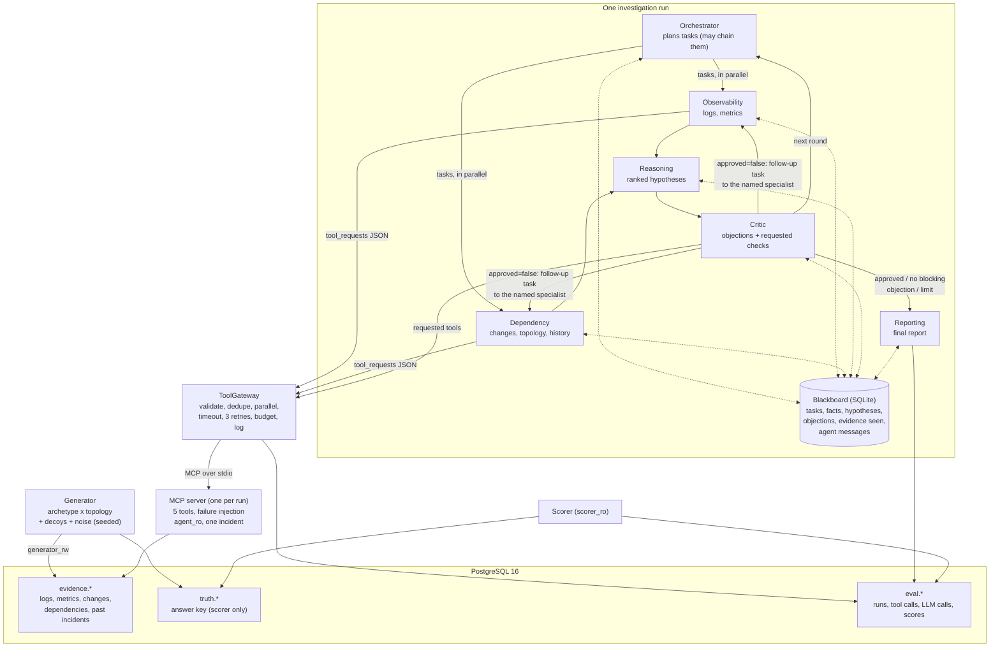

# Architecture and agent coordination

## Diagram

Every agent is one `claude -p` call (Haiku by default) with built-in tools disabled, CLAUDE.md
and plugins off (`--safe-mode`), run from an empty directory. It returns JSON validated
against a Pydantic model; invalid output is repaired at most 3 times.

## How the agents collaborate

Agents never call the tools directly and never start each other. They exchange **structured
records** through a shared blackboard, and Python routes the work:

| Record | Written by | Used by |
|---|---|---|
| Task (goal, may wait for another task) | Orchestrator | Observability, Dependency |
| Fact or assumption (cites evidence IDs) | Observability, Dependency | Reasoning, Critic, Reporting, later specialists |
| Hypothesis (component, category, mechanism, confidence, supporting/contradicting fact IDs) | Reasoning (2–4 per round) | Critic, Reporting, next Orchestrator |
| Verdict (`approved`) and objections (blocking or not, the competing explanation, the specialist who should settle it, the tool calls that would settle it) | Critic | Python routing, Reporting |
| Follow-up task (created by Python from a blocking objection) | — | the specialist the Critic named |

**One round:**
1. The **Orchestrator** reads the blackboard and plans tasks.
2. Independent tasks run in **parallel**. A task can wait for another (`after`) and then
   starts from that agent's facts (for example, "check changes on whichever service the logs
   show failing first").
3. Each specialist works in up to 3 steps: request tools, read results, record facts.
4. **Reasoning** ranks 2–4 competing hypotheses from those facts.
5. The **Critic** gives a verdict on the top hypothesis:
   - **approved**: the report is written;
   - **a blocking objection**: it must name the competing explanation and the specialist
     who can tell the two apart. Python turns it into a **follow-up task** for that
     specialist in the next round, and runs the Critic's requested tool calls first.

**Python enforces convergence:**
- a hypothesis can be blocked only once, and a repeat is stored as non-blocking;
- the last fifth of the tool budget is kept for follow-up checks.

The loop ends when:
- the Critic approves;
- no blocking objection remains;
- the round limit is reached;
- a budget or the deadline runs out.

The **Reporting** agent then writes the report. The routing decision is plain Python, never
the model.

## Agent-to-agent messages (the pattern used for eval-v4 and reruns)

`--pattern exchange` keeps the same six agents, blackboard, gateway and limits, and lets agents
write to each other. A message is stored on the blackboard and delivered in the receiver's next
turn. `--pattern blackboard` is the fixed pipeline above (eval-v3).

Python, not a model, picks who speaks next (`agents/exchange.py`, `next_speakers`):
1. the Orchestrator, if it has mail;
2. the specialists, if there are open tasks or mail for them;
3. Reasoning, if it has mail or there are new facts;
4. the Critic, if it has mail or an unreviewed ranking, up to 3 reviews;
5. otherwise, or once the Critic approves or a limit is hit, Reporting.

The mailbox is capped so that talk cannot eat the budget: 6 new messages per run, 3 of them from
specialists, 2 per turn, 600 characters each, and one open question between any pair. A reply to
an open question is free and cannot open a new one. A run ends after at most 30 turns.

## Rules enforced in code

- **Grounding**: a fact may only cite evidence IDs that tools returned in this run; a report
  may only cite such IDs; hypothesis components must be exact service names. Violations go
  back to the agent for repair.
- **Facts vs assumptions** are separate record kinds; "inconclusive" is a valid outcome.
- **Bounded**: rounds (3), specialist steps (3), tool calls (40) and LLM calls (60) per run,
  3 attempts per tool or LLM call, per-call timeouts, optional run deadline.
- **Recovery**: a failed agent marks its task failed and leaves a note; a failed orchestrator
  falls back to default tasks; a failed reporter or spent budget yields a Python-built
  inconclusive report from the blackboard. Tool timeouts and errors are retried; partial and
  empty results are not.
- **Isolation**: the MCP server is bound to one incident, uses a read-only role with
  row-level security, and exposes no SQL. Only the scorer can read the answer key.

## Tools (as named in the roadmap)

| Roadmap name | Tool here | Simulated failures used in the dataset |
|---|---|---|
| `query_logs` | `query_logs` | transient timeout, permanent outage |
| `query_metrics` | `query_metrics` | transient timeout, partial (truncated) results |
| `get_deployments` | `get_change_history` (deploys, config, flags, scaling, infra; diff on request) | permanent error, partial |
| `get_dependencies` | `get_service_dependencies` (edges with client config) | transient timeout |
| `search_historical_incidents` | `search_past_incidents` | look-alike past incidents (decoys) |

Failures are injected deterministically by the MCP server from rules stored with each
incident. The gateway retries timeouts and errors (at most 3 attempts) but never retries
partial or empty results.

## The single-agent baseline

One "investigator" agent with all five tools, the same gateway, model and budgets, looping
up to 12 steps (request tools, keep grounded notes, or return the report). It differs only in
organisation: no division of labour, no critic, no blackboard.
